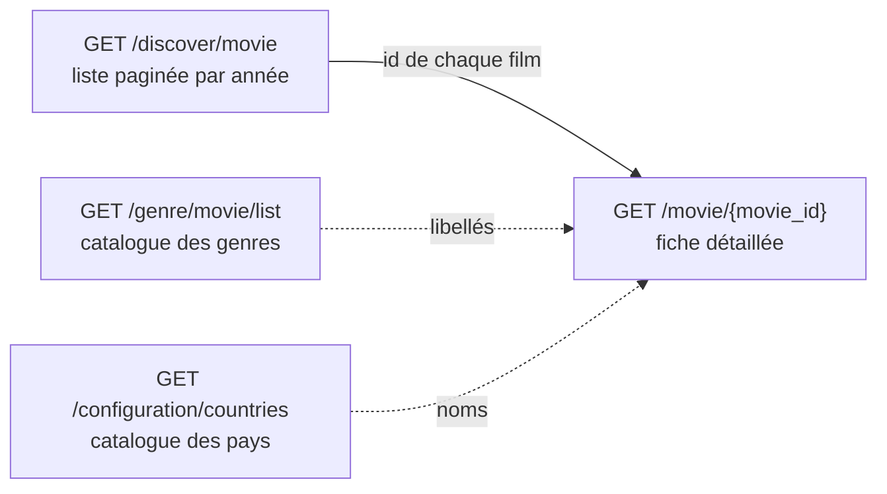
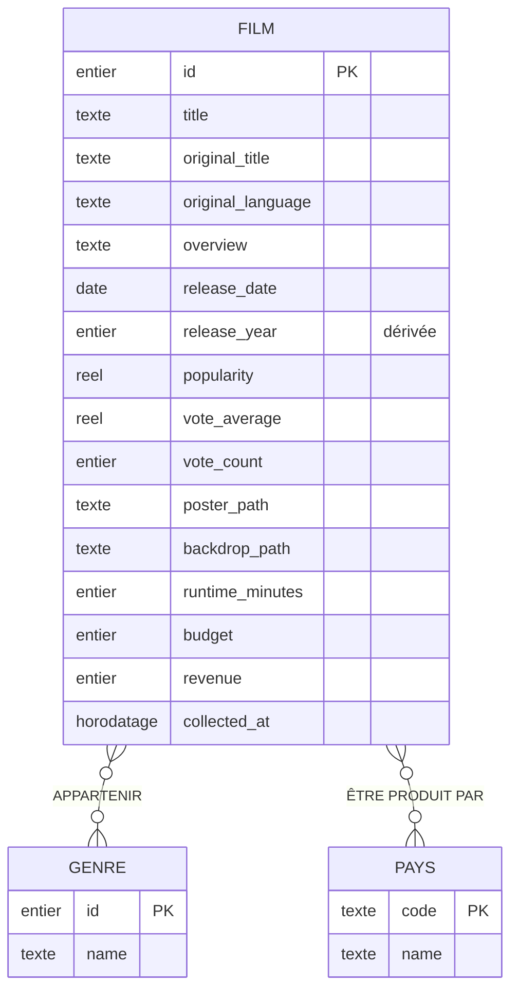

# DASHBOARD-01 — Modèle de données du tableau de bord

Ce document spécifie les données nécessaires au tableau de bord d'exploration des
films (version 2.0.0) : d'où elles viennent dans l'API TMDB, les règles métier
qui les encadrent et le **M**odèle **C**onceptuel de **D**onnées (MCD) qui en
découle. Il sert de base au schéma SQLite (DASHBOARD-02).

> Ticket : [DASHBOARD-01](https://github.com/gabrielsagot/themoviedb-discovery-app/issues/1)

## 1. Besoin d'exploration

Le tableau de bord compare les films selon leur **année de sortie** sur une
période configurable (par exemple 2015 à 2024). Il agrège et compare, par année :

- les titres ;
- les genres ;
- les pays de production ;
- les notes, le nombre de votes et la popularité ;
- les durées, budgets et recettes.

La base locale contient un **échantillon** des films de TMDB, pas un recensement
exhaustif : c'est le nombre de films importés qui détermine sa représentativité.
Les notes et la popularité sont celles **observées à la date de collecte** ; on
ne reconstitue pas leur évolution historique.

## 2. Parcours des sources TMDB

1. **Discover** (`GET /discover/movie`) fournit, page par page, les films sortis
   une année donnée (filtre `primary_release_year`). Il faut parcourir les
   différentes pages du résultat.
2. Pour chaque film retenu, la **fiche détaillée** (`GET /movie/{movie_id}`)
   complète les informations absentes de Discover : durée, budget, recettes,
   pays de production, et les genres avec leurs libellés.
3. Les **catalogues** des genres (`GET /genre/movie/list`) et des pays
   (`GET /configuration/countries`) donnent la liste complète des genres et des
   pays disponibles, y compris ceux qui ne sont encore associés à aucun film.

## 3. Dictionnaire des données

Types indiqués au niveau conceptuel : _entier_, _réel_, _texte_, _date_,
_horodatage_.

### 3.1 Film

| Propriété           | Description                                    | Type       | Source TMDB                                | Obligatoire        |
| ------------------- | ---------------------------------------------- | ---------- | ------------------------------------------ | ------------------ |
| `id`                | Identifiant TMDB du film                       | entier     | Discover `results[].id`, détail `id`       | Oui                |
| `title`             | Titre dans la langue demandée                  | texte      | Discover `results[].title`, détail `title` | Oui                |
| `original_title`    | Titre original                                 | texte      | Discover / détail `original_title`         | Oui                |
| `original_language` | Langue originale (code ISO 639-1, ex. `en`)    | texte      | Discover / détail `original_language`      | Oui                |
| `overview`          | Résumé                                         | texte      | Discover / détail `overview`               | Oui (vide accepté) |
| `release_date`      | Date de sortie (`AAAA-MM-JJ`)                  | date       | Discover / détail `release_date`           | Non                |
| `release_year`      | Année de sortie, **dérivée** de `release_date` | entier     | Calculée                                   | Non                |
| `popularity`        | Indice de popularité TMDB                      | réel       | Discover / détail `popularity`             | Non                |
| `vote_average`      | Note moyenne (sur 10)                          | réel       | Discover / détail `vote_average`           | Non                |
| `vote_count`        | Nombre de votes                                | entier     | Discover / détail `vote_count`             | Non                |
| `poster_path`       | Chemin de l'affiche                            | texte      | Discover / détail `poster_path`            | Non                |
| `backdrop_path`     | Chemin de l'image de fond                      | texte      | Discover / détail `backdrop_path`          | Non                |
| `runtime_minutes`   | Durée en minutes                               | entier     | Détail `runtime`                           | Non                |
| `budget`            | Budget en dollars US                           | entier     | Détail `budget`                            | Non                |
| `revenue`           | Recettes en dollars US                         | entier     | Détail `revenue`                           | Non                |
| `collected_at`      | Date et heure de la dernière observation       | horodatage | Renseignée par le collecteur               | Oui                |

Champs TMDB volontairement **non retenus** : `adult` et `video` (déjà exclus par
l'application), ainsi que `genre_ids` de Discover, remplacé par la relation
Film–Genre construite à partir du détail.

### 3.2 Genre

| Propriété | Description                          | Type   | Source TMDB                                       | Obligatoire |
| --------- | ------------------------------------ | ------ | ------------------------------------------------- | ----------- |
| `id`      | Identifiant TMDB du genre (ex. `35`) | entier | Catalogue `genres[].id`, détail `genres[].id`     | Oui         |
| `name`    | Libellé (ex. « Comédie »)            | texte  | Catalogue `genres[].name`, détail `genres[].name` | Oui         |

### 3.3 Pays

| Propriété | Description                              | Type  | Source TMDB                                                                    | Obligatoire |
| --------- | ---------------------------------------- | ----- | ------------------------------------------------------------------------------ | ----------- |
| `code`    | Code ISO 3166-1 alpha-2 (ex. `FR`, `BE`) | texte | Catalogue `iso_3166_1`, détail `production_countries[].iso_3166_1`             | Oui         |
| `name`    | Nom du pays                              | texte | Catalogue `native_name` / `english_name`, détail `production_countries[].name` | Oui         |

## 4. Règles de gestion

**Identification**

- **RG1** — Un film est identifié par son identifiant TMDB. Le collecter à
  nouveau **actualise** ses informations (description, indicateurs, genres,
  pays, date d'observation) sans créer de doublon ni retirer les films des
  autres années.
- **RG2** — Un genre est identifié par son **code TMDB**, jamais par son
  libellé : le libellé peut changer de langue sans changer de genre.
- **RG3** — Un pays est identifié par son code ISO 3166-1 alpha-2 (deux lettres
  majuscules).

**Relations**

- **RG4** — Un film peut appartenir à plusieurs genres (une comédie d'aventure),
  et un genre est partagé par de nombreux films.
- **RG5** — Un film peut être produit par plusieurs pays (coproduction), et un
  pays peut participer à de nombreux films.
- **RG6** — Un même genre (ou un même pays) n'est associé **qu'une seule fois**
  à un film donné.
- **RG7** — Un film sans genre ou sans pays connu reste au catalogue ; un genre
  ou un pays des catalogues peut n'être associé à aucun film.

**Valeurs absentes et calculs**

- **RG8** — L'année de sortie est **dérivée** de la date de sortie, pas de
  l'année demandée au collecteur. Si la date est absente ou inexploitable,
  l'année est inconnue : le film reste au catalogue mais ne participe pas aux
  regroupements par année.
- **RG9** — Une durée, un budget ou des recettes absents ou égaux à zéro sont
  **inconnus** ; une valeur renseignée est strictement positive.
- **RG10** — Une popularité, une note ou un nombre de votes absents restent
  inconnus, sans être remplacés par zéro.

**Exemple** : un film fictif classé « Comédie » et « Aventure », coproduit par la
France et la Belgique, donne une occurrence de Film, deux associations
_Appartenir_ (genres 35 et 12) et deux associations _Être produit par_ (`FR` et
`BE`). Il est retrouvé en explorant chacun de ces deux genres et chacun de ces
deux pays.

## 5. Modèle Conceptuel de Données (MCD)

### 5.1 Entités

| Entité    | Identifiant | Propriétés                                                                                                                                                                                                                               |
| --------- | ----------- | ---------------------------------------------------------------------------------------------------------------------------------------------------------------------------------------------------------------------------------------- |
| **FILM**  | `id`        | `title`, `original_title`, `original_language`, `overview`, `release_date`, `release_year` (dérivée), `popularity`, `vote_average`, `vote_count`, `poster_path`, `backdrop_path`, `runtime_minutes`, `budget`, `revenue`, `collected_at` |
| **GENRE** | `id`        | `name`                                                                                                                                                                                                                                   |
| **PAYS**  | `code`      | `name`                                                                                                                                                                                                                                   |

### 5.2 Associations et cardinalités

| Association          | Entités reliées | Cardinalités (Merise)            | Règles        |
| -------------------- | --------------- | -------------------------------- | ------------- |
| **APPARTENIR**       | FILM — GENRE    | FILM **(0,n)** — **(0,n)** GENRE | RG4, RG6, RG7 |
| **ÊTRE PRODUIT PAR** | FILM — PAYS     | FILM **(0,n)** — **(0,n)** PAYS  | RG5, RG6, RG7 |

Lecture des cardinalités :

- un film appartient à **0 à n** genres ; un genre regroupe **0 à n** films ;
- un film est produit par **0 à n** pays ; un pays participe à **0 à n** films.

Les deux associations sont de type **plusieurs-à-plusieurs** et ne portent
aucune propriété. Le minimum à 0 côté FILM traduit RG7 (genres ou pays parfois
absents chez TMDB) ; le minimum à 0 côté GENRE et PAYS traduit les catalogues,
qui contiennent des valeurs non encore utilisées.

### 5.3 Diagramme

