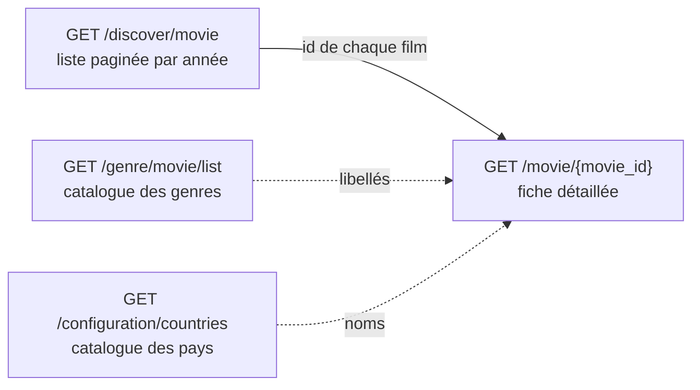
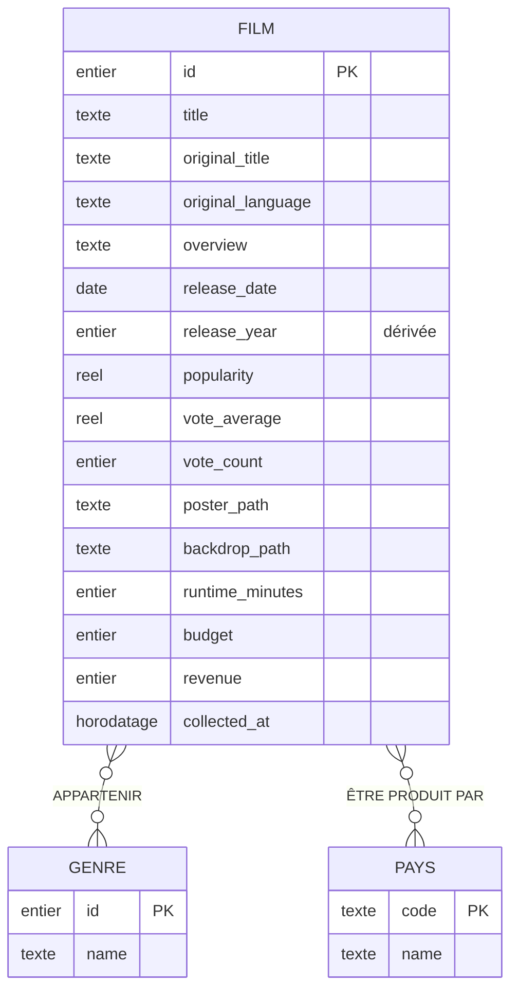
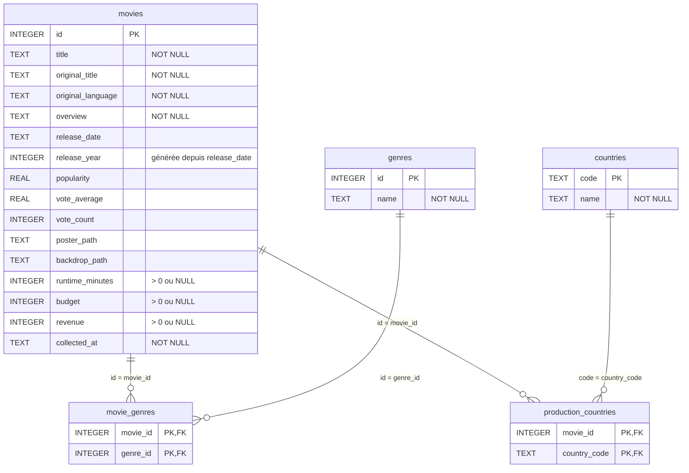

# DASHBOARD-01 — Modèle de données du tableau de bord

Ce document spécifie les données nécessaires au tableau de bord d'exploration des
films (version 2.0.0) : d'où elles viennent dans l'API TMDB, les règles métier
qui les encadrent, le **M**odèle **C**onceptuel de **D**onnées (MCD) qui en
découle, puis sa traduction en schéma relationnel avec ses contraintes
d'intégrité. Il sert de base au schéma SQLite (DASHBOARD-02).

> Ticket : [DASHBOARD-01](https://github.com/gabrielsagot/themoviedb-discovery-app/issues/1)

## 1. Besoin d'exploration

Le tableau de bord compare les films selon leur **année de sortie** sur une
période configurable (par exemple 2015 à 2024). Il agrège et compare, par année :

- les titres ;
- les genres ;
- les pays de production ;
- les notes, le nombre de votes et la popularité ;
- les durées, budgets et recettes.

La base locale contient un **échantillon** des films de TMDB, pas un recensement
exhaustif : c'est le nombre de films importés qui détermine sa représentativité.
Les notes et la popularité sont celles **observées à la date de collecte** ; on
ne reconstitue pas leur évolution historique.

## 2. Parcours des sources TMDB

1. **Discover** (`GET /discover/movie`) fournit, page par page, les films sortis
   une année donnée (filtre `primary_release_year`). Il faut parcourir les
   différentes pages du résultat.
2. Pour chaque film retenu, la **fiche détaillée** (`GET /movie/{movie_id}`)
   complète les informations absentes de Discover : durée, budget, recettes,
   pays de production, et les genres avec leurs libellés.
3. Les **catalogues** des genres (`GET /genre/movie/list`) et des pays
   (`GET /configuration/countries`) donnent la liste complète des genres et des
   pays disponibles, y compris ceux qui ne sont encore associés à aucun film.

## 3. Dictionnaire des données

Types indiqués au niveau conceptuel : _entier_, _réel_, _texte_, _date_,
_horodatage_.

### 3.1 Film

| Propriété           | Description                                    | Type       | Source TMDB                                | Obligatoire        |
| ------------------- | ---------------------------------------------- | ---------- | ------------------------------------------ | ------------------ |
| `id`                | Identifiant TMDB du film                       | entier     | Discover `results[].id`, détail `id`       | Oui                |
| `title`             | Titre dans la langue demandée                  | texte      | Discover `results[].title`, détail `title` | Oui                |
| `original_title`    | Titre original                                 | texte      | Discover / détail `original_title`         | Oui                |
| `original_language` | Langue originale (code ISO 639-1, ex. `en`)    | texte      | Discover / détail `original_language`      | Oui                |
| `overview`          | Résumé                                         | texte      | Discover / détail `overview`               | Oui (vide accepté) |
| `release_date`      | Date de sortie (`AAAA-MM-JJ`)                  | date       | Discover / détail `release_date`           | Non                |
| `release_year`      | Année de sortie, **dérivée** de `release_date` | entier     | Calculée                                   | Non                |
| `popularity`        | Indice de popularité TMDB                      | réel       | Discover / détail `popularity`             | Non                |
| `vote_average`      | Note moyenne (sur 10)                          | réel       | Discover / détail `vote_average`           | Non                |
| `vote_count`        | Nombre de votes                                | entier     | Discover / détail `vote_count`             | Non                |
| `poster_path`       | Chemin de l'affiche                            | texte      | Discover / détail `poster_path`            | Non                |
| `backdrop_path`     | Chemin de l'image de fond                      | texte      | Discover / détail `backdrop_path`          | Non                |
| `runtime_minutes`   | Durée en minutes                               | entier     | Détail `runtime`                           | Non                |
| `budget`            | Budget en dollars US                           | entier     | Détail `budget`                            | Non                |
| `revenue`           | Recettes en dollars US                         | entier     | Détail `revenue`                           | Non                |
| `collected_at`      | Date et heure de la dernière observation       | horodatage | Renseignée par le collecteur               | Oui                |

Champs TMDB volontairement **non retenus** : `adult` et `video` (déjà exclus par
l'application), ainsi que `genre_ids` de Discover, remplacé par la relation
Film–Genre construite à partir du détail.

### 3.2 Genre

| Propriété | Description                          | Type   | Source TMDB                                       | Obligatoire |
| --------- | ------------------------------------ | ------ | ------------------------------------------------- | ----------- |
| `id`      | Identifiant TMDB du genre (ex. `35`) | entier | Catalogue `genres[].id`, détail `genres[].id`     | Oui         |
| `name`    | Libellé (ex. « Comédie »)            | texte  | Catalogue `genres[].name`, détail `genres[].name` | Oui         |

### 3.3 Pays

| Propriété | Description                              | Type  | Source TMDB                                                                    | Obligatoire |
| --------- | ---------------------------------------- | ----- | ------------------------------------------------------------------------------ | ----------- |
| `code`    | Code ISO 3166-1 alpha-2 (ex. `FR`, `BE`) | texte | Catalogue `iso_3166_1`, détail `production_countries[].iso_3166_1`             | Oui         |
| `name`    | Nom du pays                              | texte | Catalogue `native_name` / `english_name`, détail `production_countries[].name` | Oui         |

## 4. Règles de gestion

**Identification**

- **RG1** — Un film est identifié par son identifiant TMDB. Le collecter à
  nouveau **actualise** ses informations (description, indicateurs, genres,
  pays, date d'observation) sans créer de doublon ni retirer les films des
  autres années.
- **RG2** — Un genre est identifié par son **code TMDB**, jamais par son
  libellé : le libellé peut changer de langue sans changer de genre.
- **RG3** — Un pays est identifié par son code ISO 3166-1 alpha-2 (deux lettres
  majuscules).

**Relations**

- **RG4** — Un film peut appartenir à plusieurs genres (une comédie d'aventure),
  et un genre est partagé par de nombreux films.
- **RG5** — Un film peut être produit par plusieurs pays (coproduction), et un
  pays peut participer à de nombreux films.
- **RG6** — Un même genre (ou un même pays) n'est associé **qu'une seule fois**
  à un film donné.
- **RG7** — Un film sans genre ou sans pays connu reste au catalogue ; un genre
  ou un pays des catalogues peut n'être associé à aucun film.

**Valeurs absentes et calculs**

- **RG8** — L'année de sortie est **dérivée** de la date de sortie, pas de
  l'année demandée au collecteur. Si la date est absente ou inexploitable,
  l'année est inconnue : le film reste au catalogue mais ne participe pas aux
  regroupements par année.
- **RG9** — Une durée, un budget ou des recettes absents ou égaux à zéro sont
  **inconnus** ; une valeur renseignée est strictement positive.
- **RG10** — Une popularité, une note ou un nombre de votes absents restent
  inconnus, sans être remplacés par zéro.

**Exemple** : un film fictif classé « Comédie » et « Aventure », coproduit par la
France et la Belgique, donne une occurrence de Film, deux associations
_Appartenir_ (genres 35 et 12) et deux associations _Être produit par_ (`FR` et
`BE`). Il est retrouvé en explorant chacun de ces deux genres et chacun de ces
deux pays.

## 5. Modèle Conceptuel de Données (MCD)

### 5.1 Entités

| Entité    | Identifiant | Propriétés                                                                                                                                                                                                                               |
| --------- | ----------- | ---------------------------------------------------------------------------------------------------------------------------------------------------------------------------------------------------------------------------------------- |
| **FILM**  | `id`        | `title`, `original_title`, `original_language`, `overview`, `release_date`, `release_year` (dérivée), `popularity`, `vote_average`, `vote_count`, `poster_path`, `backdrop_path`, `runtime_minutes`, `budget`, `revenue`, `collected_at` |
| **GENRE** | `id`        | `name`                                                                                                                                                                                                                                   |
| **PAYS**  | `code`      | `name`                                                                                                                                                                                                                                   |

### 5.2 Associations et cardinalités

| Association          | Entités reliées | Cardinalités (Merise)            | Règles        |
| -------------------- | --------------- | -------------------------------- | ------------- |
| **APPARTENIR**       | FILM — GENRE    | FILM **(0,n)** — **(0,n)** GENRE | RG4, RG6, RG7 |
| **ÊTRE PRODUIT PAR** | FILM — PAYS     | FILM **(0,n)** — **(0,n)** PAYS  | RG5, RG6, RG7 |

Lecture des cardinalités :

- un film appartient à **0 à n** genres ; un genre regroupe **0 à n** films ;
- un film est produit par **0 à n** pays ; un pays participe à **0 à n** films.

Les deux associations sont de type **plusieurs-à-plusieurs** et ne portent
aucune propriété. Le minimum à 0 côté FILM traduit RG7 (genres ou pays parfois
absents chez TMDB) ; le minimum à 0 côté GENRE et PAYS traduit les catalogues,
qui contiennent des valeurs non encore utilisées.

### 5.3 Diagramme

## 6. Schéma relationnel (MLD)

### 6.1 Règles de passage du MCD au relationnel

- Chaque **entité** devient une table ; son identifiant devient la clé
  primaire.
- Chaque association **(0,n)–(0,n)** devient une **table d'association** dont
  la clé primaire est composée des clés primaires des deux entités reliées,
  chacune étant aussi une clé étrangère.

### 6.2 Tables

Notation : clé primaire **en gras**, clé étrangère préfixée par `#`.

- **movies** (**id**, title, original_title, original_language,
  overview, release_date, release_year, popularity, vote_average, vote_count,
  poster_path, backdrop_path, runtime_minutes, budget, revenue, collected_at)
- **genres** (**id**, name)
- **countries** (**code**, name)
- **movie_genres** (**#movie_id, #genre_id**) — traduit APPARTENIR
- **production_countries** (**#movie_id, #country_code**) — traduit
  ÊTRE PRODUIT PAR

| Entité / association (MCD) | Table (MLD)            | Clé primaire                 | Clés étrangères                                             |
| -------------------------- | ---------------------- | ---------------------------- | ----------------------------------------------------------- |
| FILM                       | `movies`               | `id`                         | —                                                           |
| GENRE                      | `genres`               | `id`                         | —                                                           |
| PAYS                       | `countries`            | `code`                       | —                                                           |
| APPARTENIR                 | `movie_genres`         | (`movie_id`, `genre_id`)     | `movie_id` → `movies.id`, `genre_id` → `genres.id`          |
| ÊTRE PRODUIT PAR           | `production_countries` | (`movie_id`, `country_code`) | `movie_id` → `movies.id`, `country_code` → `countries.code` |

### 6.3 Diagramme relationnel

## 7. Contraintes d'intégrité

### 7.1 Intégrité d'entité et unicité

| Contrainte                                | Garantit                                             | Règle |
| ----------------------------------------- | ---------------------------------------------------- | ----- |
| `movies.id` clé primaire                  | Un seul enregistrement par film TMDB                 | RG1   |
| `genres.id` clé primaire                  | Un genre identifié par son code, pas par son libellé | RG2   |
| `countries.code` clé primaire             | Un pays identifié par son code ISO                   | RG3   |
| Clé primaire (`movie_id`, `genre_id`)     | Un genre n'est associé qu'une fois à un film         | RG6   |
| Clé primaire (`movie_id`, `country_code`) | Un pays n'est associé qu'une fois à un film          | RG6   |

### 7.2 Intégrité référentielle

Les clés étrangères ne sont vérifiées par SQLite que si `PRAGMA foreign_keys = ON`
est exécuté **à chaque connexion**.

| Clé étrangère                                          | Suppression du parent                               | Justification                                                                      |
| ------------------------------------------------------ | --------------------------------------------------- | ---------------------------------------------------------------------------------- |
| `movie_genres.movie_id` → `movies.id`                  | `ON DELETE CASCADE`                                 | Supprimer un film supprime ses associations, sans toucher au catalogue des genres. |
| `movie_genres.genre_id` → `genres.id`                  | Refusée tant que le genre est utilisé (`NO ACTION`) | Seuls les genres inutilisés peuvent être nettoyés (DASHBOARD-04).                  |
| `production_countries.movie_id` → `movies.id`          | `ON DELETE CASCADE`                                 | Idem pour les pays de production.                                                  |
| `production_countries.country_code` → `countries.code` | Refusée tant que le pays est utilisé (`NO ACTION`)  | Seuls les pays inutilisés peuvent être nettoyés (DASHBOARD-06).                    |

Conséquence : un genre ou un pays doit exister dans son catalogue **avant**
d'être associé à un film. Le collecteur enregistre donc d'abord les genres et
pays lus dans la fiche détaillée, puis le film, puis ses associations.

### 7.3 Contraintes de domaine

| Colonne                                                                    | Contrainte                                                           | Règle |
| -------------------------------------------------------------------------- | -------------------------------------------------------------------- | ----- |
| `title`, `original_title`, `original_language`, `overview`, `collected_at` | `NOT NULL`                                                           | —     |
| `genres.name`, `countries.name`                                            | `NOT NULL`                                                           | —     |
| `runtime_minutes`, `budget`, `revenue`                                     | `NULL` ou strictement positif (`CHECK (… > 0)`)                      | RG9   |
| `popularity`, `vote_average`, `vote_count`                                 | `NULL` autorisé (inconnu), jamais remplacé par 0                     | RG10  |
| `release_year`                                                             | Colonne **générée et stockée** depuis `release_date`, non modifiable | RG8   |

### 7.4 Actualisation d'un film (RG1)

L'actualisation d'un film déjà collecté s'effectue **dans une seule transaction** :

1. insérer ou mettre à jour la ligne `movies` (même `id`, nouveau `collected_at`) ;
2. remplacer ses lignes `movie_genres` et `production_countries` par celles de
   la dernière observation.

Si une étape échoue, la transaction est annulée et le film garde son état
précédent. Les films des autres années ne sont pas concernés.

## 8. Confrontation avec le schéma existant

Le fichier [`src/back-end/database/schema.ts`](../src/back-end/database/schema.ts),
déjà présent sur `develop`, a été comparé à ce modèle. Un script de contrôle
(base SQLite temporaire) a vérifié chaque règle.

| Vérification                                                            | Résultat                                     |
| ----------------------------------------------------------------------- | -------------------------------------------- |
| Tables, clés primaires et clés étrangères conformes au MLD              | ✅ Conforme                                  |
| Film d'exemple (Comédie + Aventure, FR + BE) retrouvé par genre et pays | ✅ Conforme                                  |
| Doublon de film, d'association film–genre ou film–pays                  | ✅ Refusé (`UNIQUE constraint failed`)       |
| Association vers un film, un genre ou un pays inexistant                | ✅ Refusée (`FOREIGN KEY constraint failed`) |
| Budget à 0, durée négative                                              | ✅ Refusés (`CHECK constraint failed`)       |
| Film sans date, sans genre, sans pays, indicateurs à `NULL`             | ✅ Accepté, année `NULL`                     |
| `release_date` vide (`''`) ou invalide (`'abc'`)                        | ✅ Année `NULL`                              |
| Écriture directe de `release_year`                                      | ✅ Refusée (colonne générée)                 |
| Suppression d'un genre utilisé / inutilisé                              | ✅ Refusée / acceptée                        |
| Suppression d'un film                                                   | ✅ Associations supprimées en cascade        |
| `release_date` réduite à l'année (`'2020'`)                             | ✅ Corrigé (DASHBOARD-02) : année `NULL`     |
| Code pays hors format ISO (`'fra'`)                                     | ⚠️ Accepté                                   |

### Points d'attention pour la suite

- **Date partielle** : SQLite lit `'2020'` comme un numéro de jour julien, pas
  comme une année. **Corrigé dans DASHBOARD-02** : `release_year` n'est
  désormais dérivée que d'une date `AAAA-MM-JJ` complète et valide ; toute autre
  valeur laisse l'année à `NULL` (RG8).
- **Format des codes pays** : la base n'impose pas deux lettres majuscules
  (RG3). La validation est prévue à l'import CSV (DASHBOARD-06) et doit aussi
  être appliquée par le collecteur.
- **Bornes des indicateurs** : aucune contrainte ne limite `vote_average` à
  l'intervalle 0–10 ni n'interdit un `vote_count` négatif. Ce n'est pas exigé
  par les règles de gestion ; une contrainte `CHECK` pourrait être ajoutée si
  besoin.

Ces points ne remettent pas en cause le modèle : il couvre l'ensemble des
règles RG1 à RG10, la responsabilité de certaines d'entre elles étant portée
par le collecteur plutôt que par le schéma.
